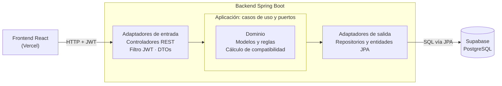

# Fundamentación técnica – Plataforma de primer empleo TI (Medellín)

Versión del 21 de octubre de 2026. Fuente principal: documento de fundamentación del equipo.

## Resumen del proyecto

Construiremos una plataforma web que conecta a estudiantes de últimos semestres y recién graduados de carreras de software en Medellín con vacantes de práctica y nivel junior, calculando su compatibilidad por habilidades y mostrando qué les falta para cada oferta.

- **Para quién:** jóvenes desarrolladores sin experiencia formal y empresas que contratan talento junior.
- **Por qué:** las vacantes junior piden experiencia que el recién graduado no tiene, mientras el sector TI reporta déficit de talento.
- **Contexto académico:** proyecto de fin de semestre de Ingeniería Informática, en pareja, 6–7 semanas, con arquitectura hexagonal, Spring Boot, Spring Security, Supabase, React, Postman, Docker y Vercel, y mínimo 5 entidades.
- **Alineación:** ODS 8, metas 8.6 (jóvenes que no estudian ni trabajan) y 8.b (estrategias de empleo juvenil).

## Problema y justificación

En Colombia uno de cada cinco jóvenes no estudia ni trabaja, y el desempleo juvenil casi duplica el general; al mismo tiempo, el sector TI lleva años reportando déficit de desarrolladores. El cuello de botella no es solo la falta de talento, sino la conexión entre el recién graduado y su primer empleo.

| Indicador | Valor | Periodo | Fuente |
| --- | --- | --- | --- |
| Jóvenes de 15 a 28 años que no estudian ni trabajan (Colombia) | 2,33 millones de 11,07 millones (≈ 21 %) | jun–ago 2026 | [DANE vía La República](https://www.larepublica.co/economia/el-numero-de-jovenes-ninis-alcanzo-su-nivel-mas-bajo-en-casi-una-decada-4503982) |
| Desempleo juvenil (Colombia) | 14,7 % | abr–jun 2026 | [DANE vía Portafolio](https://www.portafolio.co/economia/desempleo-en-colombia-en-junio-se-situo-en-8-cifra-similar-a-la-de-mayo-499400) |
| Desempleo juvenil (Medellín A.M.) | 12,9 % | abr–jun 2026 | [DANE vía El País](https://www.elpais.com.co/economia/tasa-de-desempleo-en-colombia-se-mantiene-estable-y-se-ubico-en-8-en-junio-de-2026-3146.html) |
| Desempleo general (Medellín A.M.) | 7,1 %, el más bajo del país | abr–jun 2026 | [Minuto30](https://www.minuto30.com/medellin-menor-desempleo-colombia/1714775/) |
| Brecha proyectada de desarrolladores (Colombia) | 68.000 a 112.000 | proyección a 2025 | [MinTIC vía La República](https://www.larepublica.co/alta-gerencia/de-no-tomar-acciones-colombia-tendria-deficit-de-112-000-desarrolladores-en-2025-3440141) |
| Jóvenes NEET en el mundo | 20,4 % (mujeres 28,1 %, hombres 13,1 %) | 2023 | [OIT](https://www.ilo.org/node/666121) |

**La paradoja del junior.** Una revisión de vacantes "junior" en portales colombianos (Computrabajo, Indeed, Elempleo, octubre 2026) muestra exigencias de 6 meses a 2 años de experiencia, y cada vez más piden manejo de herramientas de IA. Algunas sí aceptan estudiantes de últimos semestres, pero están dispersas entre muchas ofertas que no.

**Relación con el ODS 8.** La meta 8.6 tenía plazo en 2020 y no se cumplió; la 8.b pide estrategias de empleo juvenil. La plataforma aporta a ambas desde lo local: reduce la fricción de entrada al primer empleo formal en un sector con demanda.

Nota: la brecha de 68.000–112.000 es una proyección de MinTIC hecha en 2022; conviene presentarla como estimación, no como cifra medida.

## Antecedentes y diferenciación

Existen plataformas con matching y plataformas para recién graduados, pero ninguna combina las tres cosas que proponemos: foco en juniors de software, enfoque local en Medellín y explicación al candidato de qué le falta para cada vacante.

| Plataforma | Origen y alcance | Qué hace bien | Qué no cubre |
| --- | --- | --- | --- |
| [Torre](https://torre.ai/es/tech) | Colombia, global, enfocada en trabajo remoto | Matching con IA sobre más de 100 variables y un grafo de habilidades | No es exclusiva para juniors ni para empleo local |
| [Get on Board](https://www.getonbrd.com/help/how-does-the-get-on-board-matching-algorithm-work-to-find-tech-talent?lang=es) | Chile, Latinoamérica, solo tecnología | Matching por tecnologías, ubicación, salario y experiencia | Pocas vacantes junior: 14 % de sus empleos en 2023 ([Insights 2023](https://www.getonbrd.com/blog/insights-2023-como-se-esta-moviendo-el-mercado-laboral-tecnologico-en-latam)) |
| Computrabajo, Elempleo, Magneto, Servicio Público de Empleo | Colombia, todos los sectores | Volumen de vacantes | Sin matching por habilidades ni foco en recién graduados |
| [Handshake](https://www.edtech.com/companies/handshake) | Estados Unidos, universitario | Conecta estudiantes, universidades y empresas; más de 1.500 universidades | No opera en Colombia |

**Diferencial del proyecto.** Las plataformas existentes le dicen al candidato "estas vacantes encajan contigo"; la nuestra le dice "esto te falta para encajar", y solo muestra vacantes alcanzables para un junior (práctica o junior, sin exigir años de experiencia).

**Antecedentes útiles**

- Una [tesis del Politécnico Grancolombiano](https://alejandria.poligran.edu.co/bitstreams/b289661c-cfc7-421b-9028-491edeb0f1f2/download) (junio 2026) propone una plataforma local de primer empleo juvenil en Barranquilla e incluye una comparación funcional de plataformas; sirve como antecedente académico.
- Mintrabajo prepara el programa ["Talento Joven Colombia"](https://acmineria.com.co/wp-content/uploads/2026/06/Memoria-justificativa-Programa-de-primer-empleo.pdf) (proyecto de resolución, abril 2026), ligado al Certificado de Primer Empleo y a un incentivo tributario. Opcional: un atributo booleano `impulsaPrimerEmpleo` en Empresa conectaría el proyecto con esta política.

## Alcance y usuarios

El MVP se enfoca en Medellín y su área metropolitana, con datos nacionales como contexto. Medellín es el hub tecnológico con mejor mercado laboral del país y tiene fuentes locales (DANE por ciudad, Ruta N), lo que hace el caso defendible. Suramérica añadiría monedas, leyes laborales y datos heterogéneos sin aportar al objetivo académico.

El modelo de datos no se amarra a Medellín: la ciudad es un atributo, así que escalar a otras ciudades de Colombia es cambiar datos, no código.

| Rol | Quién es | Qué necesita |
| --- | --- | --- |
| Candidato | Estudiante de últimos semestres o egresado de hasta 2 años en software, sistemas o afines | Encontrar vacantes a su alcance y saber qué le falta |
| Empresa | Empresa de software o con área TI que contrata practicantes o juniors | Publicar vacantes y filtrar candidatos por habilidades |
| Administrador | Equipo de la plataforma | Gestionar el catálogo de habilidades y validar empresas |

## Funcionalidades del MVP

El MVP cubre el ciclo completo: la empresa publica, el candidato ve su compatibilidad y se postula, la empresa gestiona la postulación.

**Candidato**

- HU-01: Como candidato quiero registrarme e iniciar sesión para tener un perfil propio.
- HU-02: Como candidato quiero registrar mis habilidades con nivel (básico, intermedio, avanzado) y mi enlace de GitHub.
- HU-03: Como candidato quiero ver vacantes filtradas por modalidad, nivel y habilidad, ordenadas por compatibilidad.
- HU-04: Como candidato quiero ver en cada vacante mi porcentaje de compatibilidad y las habilidades que me faltan.
- HU-05: Como candidato quiero postularme y seguir el estado de mis postulaciones.

**Empresa**

- HU-06: Como empresa quiero registrarme y completar mi perfil.
- HU-07: Como empresa quiero publicar, editar y cerrar vacantes con sus habilidades requeridas.
- HU-08: Como empresa quiero ver los postulantes de cada vacante ordenados por compatibilidad.
- HU-09: Como empresa quiero cambiar el estado de una postulación (en revisión, entrevista, rechazada, contratado).

**Administrador**

- HU-10: Como administrador quiero gestionar el catálogo de habilidades y verificar empresas.

Fuera del MVP (si sobra tiempo): notificaciones por correo, carga de hoja de vida en PDF, estadísticas de habilidades más pedidas.

## Modelo de dominio

Son 8 entidades (el requisito pide 5): 6 principales y 2 de relación con atributos propios.

| Entidad | Atributos principales | Relaciones |
| --- | --- | --- |
| Usuario | id, email (único), passwordHash, rol (CANDIDATO, EMPRESA, ADMIN), activo, fechaCreacion | 1:1 con Candidato o Empresa |
| Candidato | id, nombres, apellidos, universidad, programa, estadoAcademico (ESTUDIANTE, EGRESADO), semestre, ciudad, githubUrl, resumen | 1:N con CandidatoHabilidad y Postulacion |
| Empresa | id, razonSocial, nit (único), sector, ciudad, sitioWeb, verificada | 1:N con Vacante |
| Habilidad | id, nombre (único), categoria (LENGUAJE, FRAMEWORK, BASE_DATOS, HERRAMIENTA, BLANDA) | N:M con Candidato y Vacante |
| Vacante | id, titulo, descripcion, modalidad (PRESENCIAL, HIBRIDA, REMOTA), tipo (PRACTICA, JUNIOR), salarioMin, salarioMax, ciudad, estado (ABIERTA, CERRADA), fechaPublicacion, fechaCierre | N:1 con Empresa; 1:N con VacanteHabilidad y Postulacion |
| Postulacion | id, fecha, estado (ENVIADA, EN_REVISION, ENTREVISTA, RECHAZADA, CONTRATADO), compatibilidad (%) | N:1 con Candidato y Vacante |
| CandidatoHabilidad | candidatoId, habilidadId, nivel (BASICO, INTERMEDIO, AVANZADO) | une Candidato y Habilidad |
| VacanteHabilidad | vacanteId, habilidadId, nivelRequerido, obligatoria (sí/no) | une Vacante y Habilidad |

**Reglas de negocio**

1. Un candidato no puede postularse dos veces a la misma vacante.
2. Solo se puede postular a vacantes ABIERTAS y con fecha de cierre vigente.
3. Solo empresas verificadas pueden publicar vacantes.
4. Una empresa solo ve y gestiona postulaciones de sus propias vacantes.
5. El estado de una postulación avanza en orden (ENVIADA → EN_REVISION → ENTREVISTA → CONTRATADO), y puede pasar a RECHAZADA desde cualquier estado previo a CONTRATADO.
6. La compatibilidad se calcula al postularse y se guarda, para que no cambie si el candidato edita su perfil después.

**Cálculo de compatibilidad.** Cada nivel vale 1, 2 o 3. Por cada habilidad que pide la vacante se compara el nivel del candidato con el requerido, con doble peso si es obligatoria:

```math
\text{compatibilidad} = \frac{\sum_{h \in V} w_h \cdot \min\left(1, \frac{n_c(h)}{n_r(h)}\right)}{\sum_{h \in V} w_h} \times 100, \quad w_h = \begin{cases} 2 & \text{obligatoria} \\ 1 & \text{deseable} \end{cases}
```

Donde n_c(h) es el nivel del candidato (0 si no la tiene) y n_r(h) el nivel requerido. Las habilidades con n_c < n_r forman la lista de "lo que te falta". Esta regla vive en el dominio, sin depender de la base de datos, y es la pieza ideal para pruebas unitarias.

## Arquitectura hexagonal

Todo el backend es Java con Spring Boot. La arquitectura hexagonal separa responsabilidades: el dominio no conoce la base de datos, los casos de uso son servicios de Spring que dependen de interfaces (puertos), y JPA y Supabase solo aparecen en los adaptadores de salida.



Una petición entra por un controlador REST, pasa el filtro JWT, invoca un caso de uso a través de su puerto de entrada, y el caso de uso guarda o consulta datos mediante un puerto de salida que implementa el adaptador JPA. Las flechas siguen la petición; las dependencias del código apuntan hacia el dominio.

**Estructura de paquetes (backend)**

```text
com.primerempleo
├── domain
│   ├── model          Candidato, Empresa, Vacante, Postulacion, Habilidad, enums
│   ├── service        CalculadoraCompatibilidad
│   └── exception      excepciones de negocio
├── application
│   ├── port
│   │   ├── in         PostularseUseCase, PublicarVacanteUseCase, ...
│   │   └── out        VacanteRepositoryPort, PostulacionRepositoryPort, ...
│   └── service        implementaciones de los casos de uso
└── infrastructure
    ├── adapter
    │   ├── in/web             controladores, DTOs, mappers
    │   └── out/persistence    entidades JPA, Spring Data, adaptadores
    ├── security           SecurityConfig, JwtService, JwtAuthFilter
    └── config             CORS, manejo global de errores
```

**Reglas para mantener la arquitectura**

- `domain` no usa anotaciones de persistencia (`@Entity`, `@Table`); esas solo van en el adaptador de salida.
- Las entidades JPA son distintas de los modelos de dominio; un mapper traduce entre ambas.
- Los controladores solo hablan con puertos de entrada, nunca con repositorios.
- Los casos de uso son `@Service` de Spring, con `@Transactional` donde aplique, e inyección por constructor.

## Stack y decisiones técnicas

Todas las tecnologías obligatorias tienen un rol claro, incluido el despliegue de front y back en Vercel con Docker.

| Capa | Tecnología | Decisión |
| --- | --- | --- |
| Backend | Java 21 + Spring Boot 3 (Maven) | Web, Data JPA, Validation, Security |
| Seguridad | Spring Security + JWT | Autenticación propia, sin Supabase Auth, para cumplir el requisito |
| Base de datos | Supabase (PostgreSQL) | Se usa como Postgres gestionado; conexión por JDBC con el pooler |
| Migraciones | Flyway | Esquema versionado en el repo, reproducible en local y en Supabase |
| Frontend | React + Vite + TypeScript | Definido por el tutor |
| Pruebas API | Postman | Colección con entornos local y producción |
| Pruebas código | JUnit 5 + Mockito | Unitarias en dominio y casos de uso |
| Documentación API | springdoc-openapi (Swagger UI) | Opcional; se puede importar a Postman |
| Despliegue | Vercel + Docker (front y back) | Ver sección de despliegue |

**Decisiones a tomar en la semana 1**

- Librería de estado y peticiones (por ejemplo, React Query o solo fetch con Context).
- Si los IDs serán UUID (recomendado, encaja con Supabase) o numéricos.
- Si usan Lombok y MapStruct para reducir código repetido en mappers.

## Seguridad

Autenticación sin estado con JWT firmado por el backend y autorización por rol en cada endpoint.

1. El usuario se registra o hace login en `/api/auth`; la contraseña se guarda con BCrypt.
2. El backend devuelve un JWT con el id del usuario, su rol y una expiración (por ejemplo, 2 horas).
3. El frontend envía el token en `Authorization: Bearer <token>` en cada petición.
4. `JwtAuthFilter` valida firma y expiración y carga el usuario en el contexto de Spring Security.
5. Las rutas se protegen por rol en `SecurityConfig` y con `@PreAuthorize` donde haga falta.

**Controles mínimos**

- La clave del JWT va en variable de entorno, nunca en el repositorio.
- Validación de propiedad: una empresa solo modifica sus vacantes y un candidato solo ve sus postulaciones (regla en el caso de uso, no solo en la ruta).
- CORS restringido a localhost (en Vercel front y back comparten dominio).
- Validación de entrada con Bean Validation y manejo global de errores con respuestas uniformes.
- Sesiones deshabilitadas (`STATELESS`) y CSRF desactivado solo porque la API no usa cookies.

## API REST

Unos 20 endpoints bajo `/api` cubren el MVP; cada uno corresponde a un caso de uso.

| Método | Ruta | Rol | Caso de uso |
| --- | --- | --- | --- |
| POST | /api/auth/registro | público | Registrar candidato o empresa |
| POST | /api/auth/login | público | Iniciar sesión y obtener JWT |
| GET | /api/habilidades | autenticado | Listar catálogo de habilidades |
| POST | /api/habilidades | ADMIN | Crear habilidad |
| GET | /api/candidatos/me | CANDIDATO | Ver mi perfil |
| PUT | /api/candidatos/me | CANDIDATO | Editar mi perfil |
| PUT | /api/candidatos/me/habilidades | CANDIDATO | Definir mis habilidades y niveles |
| GET | /api/empresas/me | EMPRESA | Ver mi perfil de empresa |
| PUT | /api/empresas/me | EMPRESA | Editar mi perfil de empresa |
| PATCH | /api/empresas/{id}/verificar | ADMIN | Verificar empresa |
| GET | /api/vacantes | autenticado | Buscar vacantes con filtros y paginación |
| GET | /api/vacantes/{id} | autenticado | Ver detalle de vacante |
| GET | /api/vacantes/{id}/compatibilidad | CANDIDATO | Ver mi compatibilidad y lo que me falta |
| POST | /api/vacantes | EMPRESA | Publicar vacante |
| PUT | /api/vacantes/{id} | EMPRESA | Editar vacante propia |
| PATCH | /api/vacantes/{id}/cerrar | EMPRESA | Cerrar vacante |
| POST | /api/vacantes/{id}/postulaciones | CANDIDATO | Postularme |
| GET | /api/postulaciones/me | CANDIDATO | Ver mis postulaciones |
| GET | /api/vacantes/{id}/postulaciones | EMPRESA | Ver postulantes ordenados por compatibilidad |
| PATCH | /api/postulaciones/{id}/estado | EMPRESA | Cambiar estado de una postulación |

**Colección de Postman**

- Una carpeta por recurso y dos entornos (`local`, `produccion`) con la variable `baseUrl`.
- En la petición de login, un script de prueba guarda el token: `pm.environment.set("token", pm.response.json().token)`.
- Autorización heredada a nivel de colección con `Bearer {{token}}`.
- Al menos una prueba por endpoint que verifique el código de estado, y casos negativos (401, 403, 409 por postulación duplicada).
- Exportar la colección al repo en `/postman` para entregarla con el proyecto.

## Despliegue

Frontend y backend se despliegan en un solo proyecto de Vercel, cada uno como contenedor Docker (`Dockerfile.vercel`), y la base de datos queda en Supabase. Vercel envía `/api/*` al backend y todo lo demás al frontend, así que comparten dominio y no hay CORS en producción.

| Componente | Dónde | Configuración |
| --- | --- | --- |
| Frontend (React) | Vercel, contenedor nginx | `frontend/Dockerfile.vercel`; `VITE_API_URL` vacío |
| Backend (Spring Boot) | Vercel, contenedor JRE 21 | `backend/Dockerfile.vercel`; `DB_URL`, `DB_USER`, `DB_PASSWORD`, `JWT_SECRET` |
| Enrutamiento | `vercel.json` en la raíz | Dos servicios y reglas de reescritura |
| Base de datos | Supabase (plan gratuito) | Cadena del Session pooler |
| Pruebas locales | `docker-compose.yml` | Las mismas imágenes que en Vercel |

**Cómo corre Spring Boot en Vercel.** Vercel ejecuta la imagen como una función con escalado automático: el contenedor debe escuchar en el puerto `PORT` (80 por defecto), no guarda estado en disco y se apaga tras 5 minutos sin tráfico ([guía de Vercel](https://vercel.com/kb/guide/docker-on-vercel-vs-render)). Por eso la primera petición después de un rato tarda unos segundos mientras arranca la JVM.

**Puntos a cuidar**

- Arranque en frío: inicialización perezosa de Spring y opciones de JVM para arrancar rápido; antes de la sustentación, hacer una petición para despertar el backend.
- Conexiones: cada instancia abre su propio pool, así que Hikari va con máximo 3 conexiones y se usa el pooler de Supabase.
- Supabase pausa proyectos gratuitos sin actividad prolongada; revisar que esté activo antes de la entrega.
- Los secretos se configuran en las variables de entorno del proyecto en Vercel, nunca en los Dockerfile.

## Plan de trabajo (7 semanas)

La persona A lidera backend y la B frontend, pero ambas participan en dominio y casos de uso. El sistema debe estar desplegado al final de la semana 5 para tener dos semanas de margen.

| Semana | Persona A (backend) | Persona B (frontend) | Entregable |
| --- | --- | --- | --- |
| 1 | Proyecto Spring, paquetes hexagonales, conexión a Supabase, migraciones Flyway | Proyecto React, rutas, layout, maqueta de pantallas | Repo, modelo de datos, CLAUDE.md |
| 2 | Registro, login, JWT, roles | Pantallas de login y registro, manejo del token | Autenticación funcionando de punta a punta |
| 3 | Casos de uso de habilidades, empresas y vacantes + Postman | Perfil de empresa, publicar y listar vacantes | CRUD de vacantes |
| 4 | Perfil de candidato, postulaciones, reglas de negocio | Perfil de candidato, búsqueda de vacantes, postularse | Flujo de postulación |
| 5 | Cálculo de compatibilidad + pruebas unitarias; despliegue del backend en Vercel | Vista de compatibilidad y "lo que te falta"; despliegue en Vercel | MVP desplegado |
| 6 | Gestión de estados, errores, colección Postman completa | Paneles por rol, estados de carga y error | Versión candidata |
| 7 | Correcciones, datos de prueba realistas, documentación | Pulido visual, pruebas de uso | Entrega y sustentación |

**Prácticas de trabajo en pareja**

- Una rama por funcionalidad y pull requests revisados por la otra persona.
- Contrato de la API (rutas y DTOs) acordado antes de construir cada funcionalidad, para trabajar en paralelo.
- Datos semilla con empresas y vacantes realistas de Medellín para la demo.

## Riesgos y mitigaciones

| Riesgo | Mitigación |
| --- | --- |
| La arquitectura hexagonal consume demasiado tiempo en código repetido (mappers, puertos) | Usar MapStruct y generar la estructura base en la semana 1 |
| La integración front–back falla tarde por CORS o JWT | Probar login de punta a punta en la semana 2, desplegado |
| El contenedor del backend falla o arranca muy lento en Vercel | Desplegar un "hola mundo" en Vercel en la semana 1; plan B: el mismo Dockerfile en Render |
| Alcance creciente | Lo que no esté en las historias HU-01 a HU-10 va a "fuera del MVP" |
| Servicios gratuitos dormidos el día de la sustentación | Despertar backend y Supabase antes de presentar; tener video de respaldo |

## Fuentes

- [La República – Ninis en su nivel más bajo en casi una década (DANE, jun–ago 2026)](https://www.larepublica.co/economia/el-numero-de-jovenes-ninis-alcanzo-su-nivel-mas-bajo-en-casi-una-decada-4503982)
- [Portafolio – Desempleo en Colombia, junio 2026](https://www.portafolio.co/economia/desempleo-en-colombia-en-junio-se-situo-en-8-cifra-similar-a-la-de-mayo-499400)
- [El País – Desempleo juvenil por ciudades, abr–jun 2026](https://www.elpais.com.co/economia/tasa-de-desempleo-en-colombia-se-mantiene-estable-y-se-ubico-en-8-en-junio-de-2026-3146.html)
- [Minuto30 – Medellín, ciudad con menor desempleo](https://www.minuto30.com/medellin-menor-desempleo-colombia/1714775/)
- [La República – Déficit proyectado de desarrolladores (MinTIC)](https://www.larepublica.co/alta-gerencia/de-no-tomar-acciones-colombia-tendria-deficit-de-112-000-desarrolladores-en-2025-3440141)
- [Banco de la República – Jóvenes Nini en Colombia (2026)](https://repositorio.banrep.gov.co/bitstreams/6d434bdb-0232-4035-b950-61c7782ef78e/download)
- [OIT – Global Employment Trends for Youth 2024](https://www.ilo.org/node/666121)
- [ILOSTAT – Metas 8.6 y 8.b](https://ilostat.ilo.org/covid-19-and-the-sustainable-development-goals-reversing-progress-towards-decent-work-for-all/)
- [Alcaldía de Medellín – Ruta N y formación tecnológica](https://www.medellin.gov.co/es/?p=492263)
- [Indeed Colombia – Vacantes junior developer](https://co.indeed.com/q-junior-developer-empleos.html)
- [Torre – Tecnología de matching](https://torre.ai/es/tech)
- [Get on Board – Cómo funciona su algoritmo](https://www.getonbrd.com/help/how-does-the-get-on-board-matching-algorithm-work-to-find-tech-talent?lang=es)
- [Get on Board – Insights 2023](https://www.getonbrd.com/blog/insights-2023-como-se-esta-moviendo-el-mercado-laboral-tecnologico-en-latam)
- [EdTech – Perfil de Handshake](https://www.edtech.com/companies/handshake)
- [Politécnico Grancolombiano – Tesis de plataforma de primer empleo (2026)](https://alejandria.poligran.edu.co/bitstreams/b289661c-cfc7-421b-9028-491edeb0f1f2/download)
- [Mintrabajo – Memoria justificativa Talento Joven Colombia (2026)](https://acmineria.com.co/wp-content/uploads/2026/06/Memoria-justificativa-Programa-de-primer-empleo.pdf)
- [Vercel – Runtimes](https://vercel.com/docs/functions/runtimes)
- [Vercel – Docker en Vercel vs Render](https://vercel.com/kb/guide/docker-on-vercel-vs-render)
